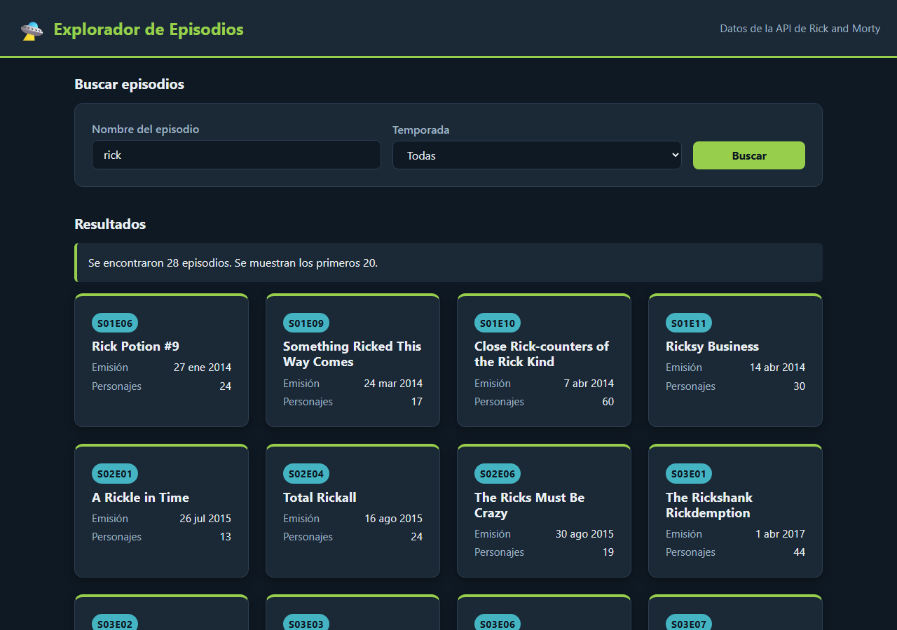

# Explorador de Episodios · Rick and Morty

**Autora:** Rocio Insaurralde
**Asignatura:** Fundamentos de Desarrollo Web · Ingeniería en Informática
**Variante:** C · Episodios (`https://rickandmortyapi.com/api/episode`)

🔗 **Página publicada:** https://roochi01.github.io/tp-insaurralde-rocio/
📁 **Repositorio:** https://github.com/roochi01/tp-insaurralde-rocio

## Descripción

Página web de una sola pantalla que permite buscar episodios de la serie *Rick and Morty*
usando su [API REST pública](https://rickandmortyapi.com/documentation). Se puede buscar
por **nombre del episodio** y filtrar por **temporada** (S01 a S05); ambos criterios se
combinan en la misma petición (`?name=...&episode=...`).

Cada resultado se muestra en una tarjeta con:

- Nombre del episodio
- Código del episodio (por ejemplo, `S01E01`)
- Fecha de emisión (`air_date`)
- Cantidad de personajes (`characters.length`)

La página también:

- Muestra «Buscando…» y desactiva el botón mientras espera la respuesta.
- Informa cuando no hay resultados (respuesta 404 de la API) y cuando ocurre un error de conexión.
- Muestra «Desconocido» si algún dato viene vacío o como `unknown`.
- Guarda la última búsqueda en `localStorage` y la repite automáticamente al recargar.
- Se adapta a pantallas de celular (probada a 375 px de ancho).

## Captura de pantalla



## Tecnologías

- HTML5 semántico (`header`, `main`, `section`, `footer`, `form` con `label`)
- CSS3: variables en `:root`, Flexbox, Grid con `repeat(auto-fill, minmax(...))` y media queries
- JavaScript ES6+: `fetch`, `async/await`, `try/catch/finally`, `new URL()` y `searchParams`,
  `createElement`/`textContent` y `localStorage`
- Git, GitHub y GitHub Pages

## Estructura

```
tp-insaurralde-rocio/
├── index.html
├── README.md
├── css/
│   └── estilos.css
├── js/
│   └── app.js
└── img/
    └── captura.png
```

## Cómo usarla

1. Abrir la página publicada.
2. Escribir parte del nombre de un episodio (por ejemplo, `rick`) y/o elegir una temporada.
3. Presionar **Buscar**.

Para probarla localmente basta con abrir `index.html` en el navegador (o usar una extensión
como *Live Server*).
